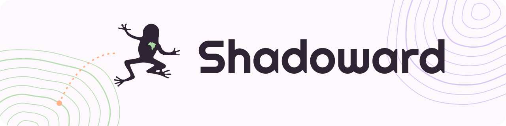
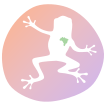

<picture>
  <source media="(prefers-color-scheme: dark)" srcset="assets/banner-dark.svg">
  
</picture>

**Automate the boring, keep the joy.** I'm the automation person, the one people ask to "just script it". Today I'm a product owner for bathymetry and charting at Fugro, and I still write code.

This page will hold my side projects. The first one, a survey data utility, is on its way. But first, here's how I got here.

### From rocks to code

I studied Earth sciences and very nearly became a paleontologist. The path bent elsewhere instead, from rock to sea to screen:

- **Field.** Inventoried underground cavities in the Maritime Alps and the Ardèche, and mapped ground movement.
- **Offshore.** Geologist on shallow- and deep-water surveys, working with sediment cores and geophysical data.
- **Data.** 14 years processing sea floor data from 40+ offshore campaigns.

Those years left three convictions behind, settled like sediment, about what makes a tool worth using.

### Principles

1. **Tools made by users, for users.** If it doesn't fit the way people already work, it isn't finished.
2. **Share the how.** Teach people to automate, rather than handing over a script.
3. **Finish with care.** Honest tools, polished down to the last detail.

### Why I build

The principles above are my *how*. My *why* is joy: work that feels lighter, so people want to keep going. The *what* is whatever I'm building at the moment, and that part will keep changing.

**Say hello.** Let's talk about automation, data processing and QC. I'm happy to chat in French, Portuguese or English. When I'm not coding, you'll find me with data visuals, design experiments, Ghibli films, and my old friends the fossils.

<i>Simple. Joyful. Made with heart.</i>

